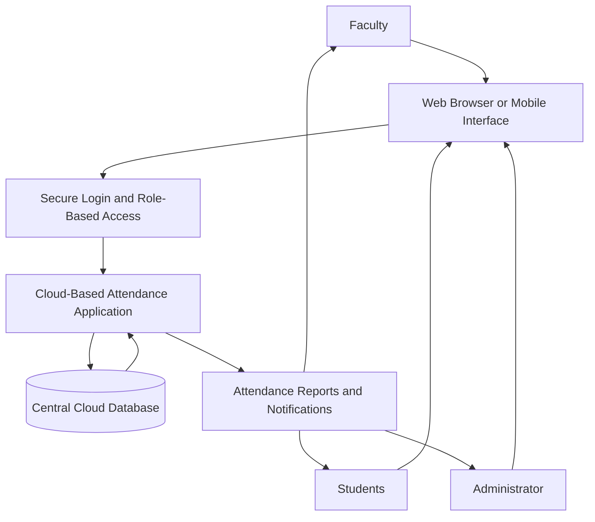

# SaaS-Based Cloud Attendance Management System

## Student Details

- **Name:** KAUSHAL V
- **USN:** NB25CSE397
- **Assigned Case Study:** Question 1 – SaaS and Cloud-Based Applications
- **Course Activity:** Software Engineering – Open-Source Contribution Project

## 1. Introduction to SaaS

Software as a Service (SaaS) is a cloud-based software delivery model in which users access an application through the internet instead of installing and maintaining it on their own computers. The service provider hosts the application, manages the servers, maintains the software, and provides updates.

A college can use a SaaS-based attendance management system to replace manual registers and separate Excel sheets. Faculty members can sign in through a web browser or mobile device, record attendance, and view reports. Students can check their attendance information using their own accounts.

## 2. Problem Analysis

The college currently records attendance manually using registers and Excel sheets. This approach can create problems such as:

- Maintaining and searching large amounts of attendance data takes time.
- Calculating attendance percentages manually can lead to errors.
- Faculty members may find it difficult to access records when they are away from campus.
- Preparing monthly or semester attendance reports requires additional effort.
- Separate files may create duplicate or outdated records.

The proposed system should store attendance information centrally and make it available to authorised users.

## 3. Proposed SaaS Attendance Management System

The college can subscribe to or deploy a SaaS attendance application hosted on a cloud platform. Users access the system using a browser or mobile-friendly interface.

The system will have different roles:

- **Administrator:** Manages departments, courses, subjects, faculty accounts, student accounts, and class schedules.
- **Faculty:** Views assigned classes, marks attendance, edits records when permitted, and generates reports.
- **Student:** Views personal attendance records and attendance percentage.

Attendance data is stored in a central cloud database. Role-based access ensures that each user can access only the information permitted for their role.

### 3.1 Essential Features

1. **Secure login and role-based access:** Separate administrator, faculty, and student accounts. Access permissions protect attendance records.
2. **Class and student management:** The administrator can maintain student lists, subjects, sections, faculty assignments, and class schedules.
3. **Digital attendance marking:** Faculty can select a class and date, mark students as present or absent, and save the record.
4. **Attendance calculation and reports:** The system automatically calculates attendance percentages and generates daily, monthly, and semester-wise reports.
5. **Student attendance dashboard:** Students can view their subject-wise attendance and identify classes they have missed.
6. **Notifications and alerts:** The system can notify students when their attendance falls below the college's specified threshold.
7. **Data backup and record history:** Regular backups and a record of authorised changes help protect attendance information.

## 4. How Cloud-Based Access Benefits Faculty and Students

1. **Access from anywhere:** Faculty can access attendance records from the campus, home, or another location with an internet connection. Students can also check their attendance without visiting the faculty office.
2. **Centralised and updated information:** Attendance is stored in one central database. Once a record is saved, authorised users can view the updated information without exchanging Excel files.
3. **Time saving and easier monitoring:** Automatic percentage calculation and report generation reduce manual work. Students can monitor their attendance regularly, while faculty can identify attendance shortages earlier.

## 5. Two Possible Challenges

### 5.1 Internet Connectivity

The system depends on internet access. If the campus network is slow or unavailable, faculty may not be able to mark or view attendance at that moment.

**Possible approach:** Provide a reliable campus network, show clear save-status messages, and consider a controlled temporary offline-entry option that synchronises records when the connection returns. The system should check for duplicate or conflicting entries during synchronisation.

### 5.2 Data Security and Privacy

Attendance records contain personal student information. Unauthorised access, weak passwords, or data breaches could expose these records.

**Possible approach:** Use secure authentication, role-based permissions, encrypted connections, regular security updates, backups, and audit logs. The college should define who can view or modify records and retain data only according to its policies.

## 6. Simple System Architecture Diagram

The following diagram shows how users access the SaaS application and how attendance information is stored.

**Diagram explanation:** Faculty, students, and administrators use a browser or mobile interface to access the application. After secure login, the cloud application checks the user's role and performs the permitted operation. Attendance information is stored in the central cloud database. Reports and notifications are then made available to authorised users.

## 7. Conclusion

A SaaS-based cloud attendance management system can replace manual registers and separate Excel sheets with a centralised digital solution. It helps faculty mark attendance and prepare reports more efficiently, while students can monitor their attendance from anywhere. Secure login, role-based access, reliable backups, and good internet connectivity are important for successful implementation. Therefore, SaaS is a suitable approach for making the college attendance process more accessible, organised, and efficient.
