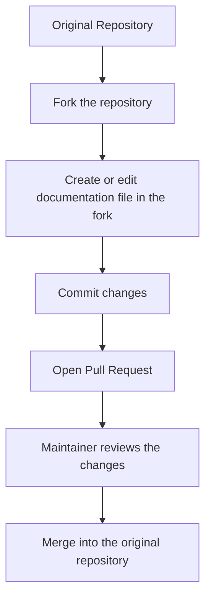

# Open Source Contribution to a Library Management System

**Name:** Drishi Raj
**SAN:** SAN-2604299
**Case Study:** Open-Source Software Engineering

## 1. Introduction

Open-source software is software whose source code is publicly available. Anyone can view it, use it, modify it and share it. Open-source software engineering is the practice of building software together with a community of developers, who report problems, fix bugs, add features and improve documentation. GitHub is the most popular platform for this kind of collaboration.

Contributing to open-source projects is important because it:
- improves the quality of software through many reviewers,
- helps students and beginners learn real-world development,
- builds a public record of a developer's work,
- keeps projects alive and up to date.

## 2. Problem Analysis

A group of developers is working on an open-source Library Management System hosted on GitHub. A student notices that the project has no documentation explaining how users can **issue and return books**. As a result:
- new users do not know how to use these features,
- new contributors find it hard to understand the project,
- developers have to answer the same questions again and again.

## 3. Proposed Solution

The student contributes by writing a documentation file (for example `Issue_and_Return_Books.md`) and submitting it through the standard GitHub workflow.

### Steps to fork a repository
1. Log in to GitHub and open the project repository.
2. Click the **Fork** button at the top right.
3. Select your account as the owner and click **Create fork**.
4. A copy of the repository now exists in your own account.

### Creating or modifying a documentation file
1. Open your fork and go to the `docs` or `contributions` folder.
2. Click **Add file -> Create new file** (or open an existing file and click the pencil icon to edit it).
3. Write the documentation in Markdown, for example: how to search for a book, how to issue a book, how to return a book and how fines are calculated.

### Committing changes
1. Click **Commit changes**.
2. Write a clear commit message, for example `Added documentation for issuing and returning books`.
3. Commit directly to the `main` branch of your fork.

### Submitting a Pull Request
1. Open the main page of your fork.
2. Click **Contribute -> Open pull request**.
3. Check that the base repository is the original project and the head repository is your fork.
4. Enter a title such as `Add documentation for issue and return of books` and click **Create pull request**.
5. The project maintainer reviews the changes, may ask for corrections, and then merges the pull request.

## 4. GitHub Contribution Workflow Diagram

## 5. Benefits and Challenges

### Benefits of collaborative software development
- Many people review the work, so quality improves.
- Knowledge is shared and everyone learns from each other.
- Every change is tracked, so mistakes can be reversed.
- Projects get new features and fixes faster.

### Challenges
- The maintainer may take time to review pull requests.
- Changes can conflict with changes made by other contributors.
- Contributors must follow the project's rules and style.

## 6. Conclusion

By forking the repository, adding clear documentation for issuing and returning books, committing the changes and submitting a Pull Request, a student can improve an open-source Library Management System without touching the original code directly. This workflow makes collaboration safe, transparent and easy to review, and it shows how open-source contribution benefits both the project and the contributor.
